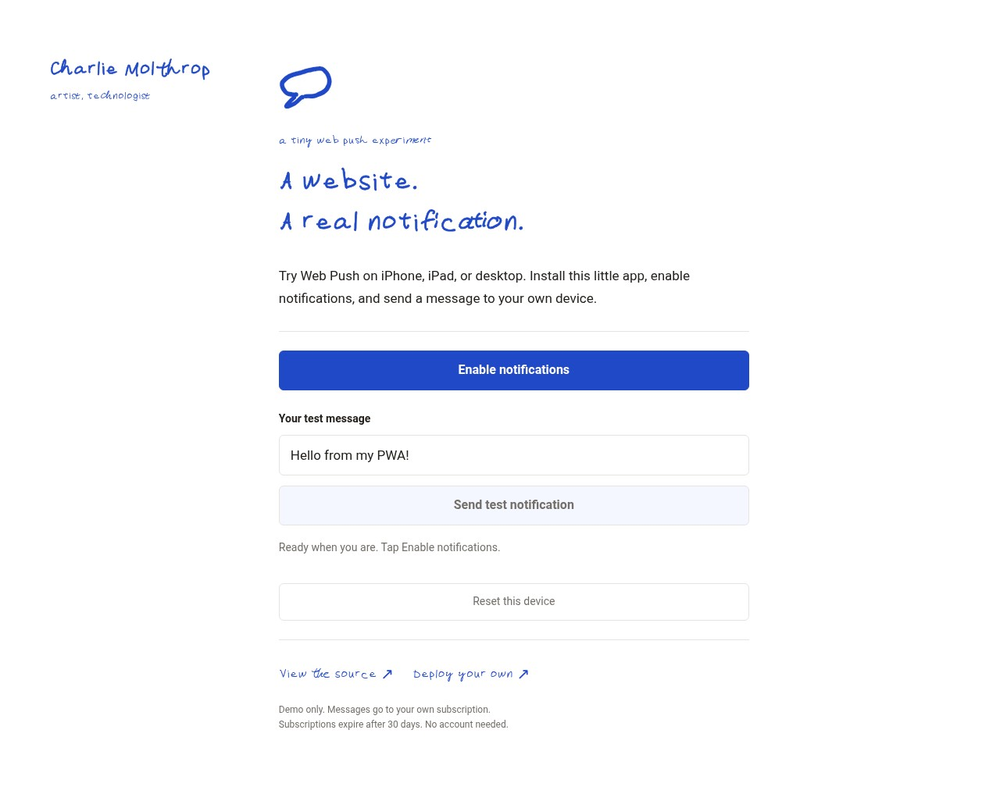

# iOS PWA push notifications

**[Try the live demo](https://charliemolthrop.com/ios-push-pwa-example/)** · **[Original Val Town source](./index.ts)**

[](https://deploy.workers.cloudflare.com/?url=https://github.com/dcm31/iOS-PWA)

[](https://charliemolthrop.com/ios-push-pwa-example/)

[Mobile screenshot](./docs/screenshot-mobile.jpg)

A small installable web app that sends an encrypted Web Push notification to your own device. The live demo links back here; the button creates a copy in your own GitHub/Cloudflare account.

## Try it on your iPhone or iPad

1. Use **iOS/iPadOS 16.4 or later** and open the live demo in Safari.
2. Tap **Share → Add to Home Screen**.
3. Launch the app from its Home Screen icon.
4. Tap **Enable notifications**, then allow the permission prompt.
5. Enter a message and tap **Send test notification**. Check Notification Center and Focus settings if it is silent.

Compatible desktop browsers can also try the page directly. The demo supports Apple, Google/Chrome, and Mozilla/Firefox push endpoints. A successful send means the push service accepted it, not that the device displayed it.

## Deploy your own

Click **Deploy to Cloudflare** above, choose your repository and Worker name, and complete Cloudflare's deployment flow. Use the detected **`npm run deploy`** command. The root `cloudflare.config.ts` declares the Worker and SQLite-backed Durable Objects; `cf deploy` provisions them. No keys or storage IDs need to be copied from this demo.

For local development, use Node **24.22.1** (or a supported newer LTS release):

```sh
npm ci
npm run dev
```

For a command-line deployment:

```sh
npx cf auth login
npm run deploy
```

Choose your own Cloudflare account. The repository contains no account ID or credentials. Change `name` in `cloudflare.config.ts` if you want a different local deployment name; Workers Builds can override it when deploying a remix. Cloudflare's normal usage limits and charges apply.

## Custom paths and styling

The app works at `/` and `/ios-push-pwa-example/`. The [live subpath test](https://ios-pwa.charliemolthrop.workers.dev/ios-push-pwa-example/) exercises the latter. A bare `/ios-push-pwa-example` redirects to the trailing-slash URL. The manifest ID, start URL, scope, asset URLs, local-storage key, and service-worker registration stay inside the selected path. Notification clicks return to that scope.

To mount it on an existing proxied Cloudflare site, add only the exact `/ios-push-pwa-example` route and `/ios-push-pwa-example/*` route for your hostname to this Worker. Inspect existing routes first. Custom-domain DNS/routing is deliberately not included in the remix configuration, so deploying a copy never claims the original site’s hostname. The primary demo at [`charliemolthrop.com/ios-push-pwa-example/`](https://charliemolthrop.com/ios-push-pwa-example/) is served by a narrow proxy in the existing Val Town personal-site router. DNS, homepage content, and other routes are unchanged. The adapter source is in [`integration/personal-site-proxy.ts`](./integration/personal-site-proxy.ts); it is specific to this site's deployment and is not loaded by the standalone Workers build. It forwards only this exact path/subtree to the fixed Worker, validates the original browser Origin before adapting it, forwards bearer authorization without cookies or client-supplied IP headers, rewrites canonical/redirect URLs to the personal domain, and retains the scoped service-worker header.

The standalone [workers.dev demo](https://ios-pwa.charliemolthrop.workers.dev) remains available. Each remix deploys its own Durable Object storage and generates its own keys; it does not use this site proxy.

The design uses Charlie’s [Fullerfont](https://github.com/dcm31/myfont) and the existing [hand-drawn speech-bubble icon](https://dcm31--207685866ff511f1a5b41607ee4eb77e.web.val.run/icon/bubble.svg) from [his site](https://charliemolthrop.com/). They are bundled locally, including PNG Home Screen icons. The page follows the site’s blue-on-white and gold-on-dark palette. These assets retain their existing ownership; this repository does not grant a new license for them.

Pages include a descriptive title, description, canonical URL, Open Graph metadata, and a social preview icon. Canonical and social URLs use each deployment’s own origin and path. Screenshots show the actual deployed UI: desktop on the standalone Worker, mobile on the personal-domain route. The mobile image is browser emulation, not proof of physical iOS delivery. The personal-domain app also reached “Ready” in a local desktop browser after service-worker registration; the remote screenshot browser received a 403 for that registration, so it was not used as desktop readiness evidence.

## How the Workers version works

`src/worker.ts` serves the page, manifest, icons, service worker, and API. Each installation gets a random bearer token and its own Durable Object. The object generates a new VAPID keypair using Web Crypto and keeps the private key and subscription in its own storage. `@block65/webcrypto-web-push` 2.0.0 builds the encrypted `aes128gcm` payload and VAPID authentication accepted by Apple. The service worker displays the notification.

The token stays in that browser's local storage and authorizes only its own subscription. Session tokens are never placed in URLs, and the app does not log private keys, subscription details, or message contents. Data expires after 30 days; **Reset this device** removes the server-side session and browser subscription. Messages are encrypted for the device and are not persisted by the app. Cloudflare request logs and sampled traces are enabled; automatic telemetry can include request URLs, including push-provider endpoints.

Basic abuse controls include HTTPS push-provider allowlisting, blocked redirects, subscription key validation, same-origin POSTs, bounded request/message sizes, 30 API requests/minute and 5 new sessions/hour per IP, and a 10-second send cooldown per installation. Expired subscriptions are removed when a push service returns 404/410.

This remains a **public demo, not a production notification system**. The token is a capability, not a user account; anyone who obtains it can act on that installation. There is no identity verification, endpoint-ownership challenge, distributed bot defense, or delivery guarantee. Shared-IP limits can affect unrelated visitors. In particular, visitors to the personal-domain demo share the Val proxy’s egress IP, so its 30 API requests/minute and 5 new sessions/hour limits are shared across those visitors. The standalone Worker applies them to connecting client IPs. The 10-second send cooldown remains per installation. Do not use it for sensitive messages or expose a broadcast feature without additional controls.

## Original Val Town version

Root [`index.ts`](./index.ts) is the unchanged original from [`dcm31/iosPushNotify`](https://www.val.town/x/dcm31/iosPushNotify/code/index.ts). It is a reference file; the Workers build starts at `src/worker.ts`.

To run the original, remix that Val or copy `index.ts` into an HTTP val, then follow the Home Screen/permission steps above using its HTTPS endpoint. It uses Hono, `npm:web-push@3.6.7`, and Val Town blob storage. Its keys are generated at runtime. No original runtime blobs, subscriptions, or environment secrets were copied.

The original is less hardened: it has **no authentication or rate limiting, accepts unvalidated push endpoints, and serves placeholder icons**. It is retained as-is, not presented as production-ready.

## Verification

```sh
npm run check
```

Runs the build, TypeScript check, Workers-runtime tests, and independent payload-decryption/VAPID-signature checks. Proxy checks also verify exact-path routing, hostile/missing Origin rejection, request method/body/query/auth forwarding, cookie/IP-header filtering, canonical/redirect rewriting, and scoped response headers.

Runtime tests cover root/subpath routing and SEO, origin/auth checks, oversized bodies, endpoint/key validation, separate sessions, durable state after eviction, expiry cleanup, send cooldowns, native Workers request construction, and mocked push-service responses/redirects.

A live transport regression was fixed: Workers rejects `redirect: "error"` before sending a request. The sender now uses `manual` and explicitly rejects 3xx responses. A synthetic invalid Apple subscription received an HTTP 400 from Apple after the fix, confirming live provider connectivity without claiming notification delivery. The disposable test session was deleted.

No end-to-end notification delivery test on a physical iPhone has been performed. Local mocked delivery and HTTP smoke checks do not establish iOS delivery. The personal-domain page, SEO, manifest, scoped service worker, assets, session lifecycle, and API error paths were checked live without sending to a user device. The Deploy button and its build configuration are provided; the full new-account remix/sign-in flow has not been exercised.

References: [iOS Web Push](https://webkit.org/blog/13878/) · [Deploy to Cloudflare buttons](https://developers.cloudflare.com/workers/platform/deploy-buttons/) · [Cloudflare configuration](https://developers.cloudflare.com/cf/projects/cloudflare-config/) · [Web Push library](https://github.com/block65/webcrypto-web-push)
